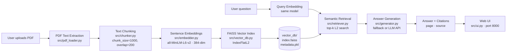

# AI Document Intelligence & RAG Assistant

A local Retrieval-Augmented Generation (RAG) system that lets you upload a PDF,
ask natural-language questions about it, and receive grounded answers backed by
exact page-number and source-file citations — all running on your machine with
no mandatory API keys.

---

## Overview

AI Document Intelligence is a self-contained RAG pipeline built from modular,
independently-testable components. Upload any PDF document through the web
interface, then ask questions. The system retrieves the most relevant passages
using semantic search and generates an answer that is strictly grounded in those
passages. If the document does not contain enough information to answer the
question, the system says so instead of hallucinating.

---

## Key Features

- **PDF Upload** – drag-and-drop or file-picker upload via a clean browser UI
- **Semantic Retrieval** – FAISS vector search over 384-dimensional sentence embeddings
- **Grounded Generation** – answers reference only what is in the document
- **Source & Page Citations** – every answer includes the originating page and filename
- **Out-of-Document Refusal** – explicit "not enough information" response for irrelevant questions
- **No Mandatory API Key** – deterministic extractive fallback works without any LLM subscription
- **Optional LLM Upgrade** – plug in an OpenAI or Groq key for higher-quality prose answers
- **Built-in Evaluation** – reproducible 5-question evaluation framework with four metrics

---

## Architecture



---

## How RAG Works

1. **Ingest** – the PDF is split into overlapping 1,000-character chunks. Each chunk keeps its page number and source filename.
2. **Embed** – every chunk is encoded by `all-MiniLM-L6-v2` into a 384-dimensional vector and stored in a FAISS index.
3. **Retrieve** – the user's question is embedded with the same model and the *k* nearest chunks are fetched by L2 distance.
4. **Generate** – the retrieved chunks are passed to the generator, which extracts relevant sentences and appends inline citations. If an external LLM key is configured it is called instead.
5. **Respond** – the UI displays the answer and lists all `[Source: filename, Page: N]` citations.

---

## Tech Stack

| Layer | Library |
|---|---|
| PDF parsing | [PyMuPDF](https://pymupdf.readthedocs.io/) (`fitz`) |
| Text chunking | [LangChain Text Splitters](https://python.langchain.com/) |
| Embeddings | [sentence-transformers](https://www.sbert.net/) · `all-MiniLM-L6-v2` |
| Vector index | [FAISS](https://github.com/facebookresearch/faiss) (`faiss-cpu`) |
| Web server | Python `http.server` (stdlib, no framework) |
| LLM (optional) | OpenAI API · Groq API |

---

## Project Structure

```
ai-document-intelligence/
├── app.py                   # Entry point – starts the web server
├── requirements.txt         # Python dependencies
├── .env.example             # Template for API-key configuration
├── .gitignore
│
├── src/                     # Core RAG components
│   ├── pdf_loader.py        # PDF → page list (PyMuPDF)
│   ├── chunker.py           # Pages → overlapping chunks
│   ├── embedder.py          # Chunks → 384-dim embeddings
│   ├── vector_db.py         # FAISS index + metadata store
│   ├── retriever.py         # Semantic retrieval (top-k search)
│   ├── generator.py         # Grounded answer generation + citations
│   ├── rag_pipeline.py      # End-to-end orchestration
│   └── ui.py                # HTTP server + HTML web interface
│
├── evaluation/
│   ├── evaluate_rag.py      # Reproducible evaluation framework
│   └── results.json         # Latest evaluation output (git-ignored)
│
├── vector_db/               # Persisted FAISS index (git-ignored)
│   ├── index.faiss
│   └── metadata.pkl
│
└── data/                    # Drop PDFs here for batch ingest (git-ignored)
```

---

## Installation

**Requirements:** Python 3.10 or later, pip.

```bash
# 1. Clone the repository
git clone https://github.com/YOUR_USERNAME/ai-document-intelligence.git
cd ai-document-intelligence

# 2. Create and activate a virtual environment
python -m venv venv
# Windows
venv\Scripts\activate
# macOS / Linux
source venv/bin/activate

# 3. Install dependencies
pip install -r requirements.txt
```

> **Note:** The first run downloads the `all-MiniLM-L6-v2` model (~90 MB) from HuggingFace Hub automatically.

---

## Environment Variables

The application works out of the box **without any API key**. To enable a higher-quality LLM for answer generation:

```bash
cp .env.example .env
```

Then edit `.env`:

```ini
# Optional – OpenAI
OPENAI_API_KEY=sk-...

# Optional – Groq (free tier available)
GROQ_API_KEY=gsk_...
```

The `.env` file is listed in `.gitignore` and will never be committed to version control.

---

## How to Run

```bash
python app.py
```

Open your browser at **http://localhost:8000**.

1. Click **Choose File** and upload a PDF.
2. Type your question in the text box and press **Ask**.
3. The answer appears with inline `[Source: filename, Page: N]` citations.

---

## Example Questions

After uploading a research paper on steganographic malware detection:

| Question | Expected behaviour |
|---|---|
| *"What dataset was used in the experiments?"* | Answer with page citation from the experiments section |
| *"Why are Deep Neural Networks good candidates to reveal hidden threats?"* | Explanation with citation from the introduction |
| *"What classifier is proposed to detect steganographic threats in images?"* | DNN-based classifier description with citation |
| *"What is the main objective of this research paper?"* | Objective statement with citation |
| *"What is the capital of Australia?"* | `"The provided documents do not contain sufficient information to answer this question."` with no citations |

---

## Evaluation Results

The evaluation script (`evaluation/evaluate_rag.py`) runs a fixed 5-question test against the existing vector database and reports four metrics.

> **Important:** These results are from a **5-question evaluation set** on a single research paper. They reflect the performance of the system on that specific document and should not be generalised as accuracy figures for arbitrary documents or question types.

| Metric | Result | Details |
|---|---|---|
| **Retrieval Hit Rate** | 75% | 3 / 4 answerable questions retrieved ≥ 1 expected page |
| **No-Info Accuracy** | 100% | 1 / 1 out-of-document question correctly refused |
| **Citation Presence Rate** | 100% | 4 / 4 answerable questions returned ≥ 1 citation |
| **Avg Chunks Retrieved** | 5.0 | Per question, top_k = 5 |

To reproduce:

```bash
python evaluation/evaluate_rag.py
```

---

## Limitations

- **Single-document focus per session** – the vector index accumulates chunks from every uploaded PDF. For isolated per-document queries, clear and re-ingest.
- **Deterministic fallback quality** – without an LLM API key, answers are extractive (exact sentences from chunks) rather than synthesised prose.
- **Retrieval hit rate** – semantic similarity may miss the exact page for abstract or broad questions whose wording differs significantly from the document text.
- **No authentication** – the web server has no user accounts or access control; intended for local use only.
- **English-optimised** – the embedding model and stopword list are tuned for English text.

---

## Future Improvements

- [ ] Per-document index isolation (query only a selected document)
- [ ] Re-ranking with a cross-encoder for higher retrieval precision
- [ ] Streaming answer display in the UI
- [ ] Multi-document comparison queries
- [ ] Docker containerisation for one-command deployment
- [ ] Support for additional file formats (DOCX, TXT, HTML)
- [ ] User authentication and multi-user session management

---

## License

This project is released under the [MIT License](LICENSE).

